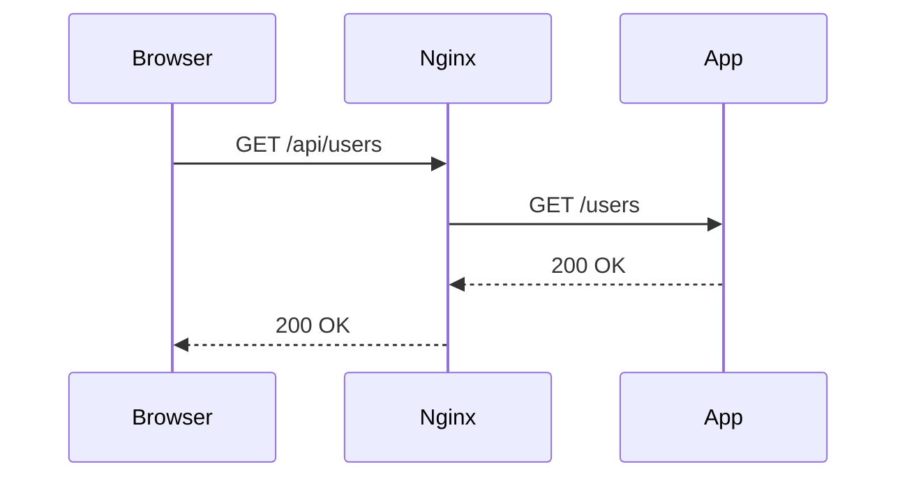

# Support assets and visual aids

This guide tells you when and how to add support to the text of a lesson: diagrams, tables, and asset files (HTML pages, screenshots, Docker Compose files, seed data, sample files). The `new-lesson` skill and its agents (`lesson-theory-writer`, `lesson-exercise-writer`) follow it.

## The main rule: add an aid only when it helps

An aid costs reading time and maintenance. Add it only when it helps the student more than text does. Before you add an aid, ask these questions:

1. **Does the text alone make the idea harder to understand?** For example: a flow with many steps, a structure with many parts, a visual result, or a comparison of many items on the same points.
2. **Does the student lose time on a task that is not the goal?** For example: the exercise is about SQL queries, but the student must first install and configure a database.
3. **Does the aid show something that the text cannot show?** For example: the look of a page, the order of messages between services, the shape of a tree.

If all answers are "no", do not add the aid. Most topics need zero or one aid. Do not add an aid only for decoration, only to make the file look complete, or only because the subject is visual.

Do not repeat the same information in two forms. If a diagram shows the flow, the text explains *why*, not the same steps again.

## Choose the right aid

| Aid | Use it when | Do not use it when |
| --- | --- | --- |
| Markdown table | You compare 3 or more items on the same points (e.g. `let` vs. `const` vs. `var`), or you list options with their effects (flags, HTTP status codes, isolation levels). | There are only 2 short items, or one point to compare. Use a sentence. |
| Mermaid diagram | The idea has a structure or an order: a flow, a sequence of calls between parts, a state machine, classes and their relations, a data model, an architecture. | The idea is linear and short (3 steps or fewer). Use a numbered list. |
| ASCII diagram | The picture is small and exact (e.g. a memory layout, an array with indexes, a folder tree), or Mermaid cannot draw it. | Mermaid draws it clearly. |
| HTML page (and its screenshot) | The result is visual: layout, styles, a component, a form, an animation. The student must *see* the result to understand it. | The topic is about logic, not about the look. |
| Docker Compose file | An exercise needs a service (database, cache, message broker, web server) and the setup of the service is **not** the goal of the exercise. | The goal of the exercise is to write the Dockerfile or the Compose file. Then the student writes it. |
| Seed data, fixtures, sample files | An exercise needs realistic data or input files (a SQL schema with rows, a log file, a JSON payload, a broken config to fix). | The student must design the data as part of the exercise. |
| Starter project files | The exercise needs boilerplate that is not the goal (e.g. an HTML page that the student styles, a config file for a build tool). | The boilerplate is the topic. |

## Where to put the files

All paths are relative to the lesson folder `Lessons/<NN>_<subject>/`.

| Where the aid is used | Folder | Examples |
| --- | --- | --- |
| `theory.md` or `practice.md` of a topic | `Theory/<N>_<topic>/assets/` | `assets/flexbox_row.html`, `assets/flexbox_row.png` |
| `exercise.md`, as an illustration (e.g. the expected look) | `Exercises/<N>_<name>/assets/` | `assets/expected_result.png` |
| An exercise, as setup that the student runs | `Exercises/<N>_<name>/` (the root of the exercise folder) | `compose.yaml`, `seed.sql`, `.env.example` |
| `quiz.md` | `assets/` (in the lesson folder) | `assets/quiz_4_layout.png` |

Rules:

- Use short `snake_case` file names in English.
- Link each asset from the Markdown file with a relative path, e.g. `` or `[open the page](assets/flexbox_row.html)`.
- Every asset must be used by a Markdown file. Do not leave unused files.
- The student never writes in an `assets/` folder. The `lesson-checker` agent and the `check-progress` skill do not count these files as student work.
- Put only the final files in the study repository. Do all the work (screenshots, tests, container runs) in a temporary directory outside the study repository.

## Mermaid diagrams and tables

Write them inline in the Markdown file:

````markdown

````

Rules:

- Use the diagram type that fits: `flowchart` (decisions and steps), `sequenceDiagram` (messages between parts), `classDiagram` (classes, interfaces, patterns), `erDiagram` (data models), `stateDiagram-v2` (states and transitions).
- Keep a diagram small: about 12 nodes or fewer. Split a large diagram into two, or show only the part that the section explains.
- Use the same names in the diagram and in the text and the code.
- Put labels with special characters (`()`, `:`, `/`, `<>`, `{}`) in double quotes, e.g. `A["save(user)"]`. Write the labels in the language of the study profile.
- Add one sentence before the diagram that tells the reader what to look at.
- If the Mermaid CLI (`mmdc`) is available, render the diagram in the temporary directory to check the syntax. If it is not available, use only the simple syntax of the examples in the Mermaid documentation.
- In a table, keep each cell short. If a cell needs more than one sentence, the table is the wrong aid.

## HTML pages and screenshots

Use them mostly for frontend subjects (HTML, CSS, a UI framework, accessibility, responsive design).

- Write one small, self-contained HTML file for each idea. Put the CSS and the JavaScript in the same file, with no build step and no external dependencies, unless the topic is about them.
- Keep only the code that shows the idea. Add short comments that point to the important lines.
- Take a screenshot so that the student can see the result in the Markdown file without opening a browser. Find a headless browser in this order: `chromium`, `chromium-browser`, `google-chrome`, `google-chrome-stable`, `microsoft-edge`, then Playwright (`npx playwright screenshot`) if it is already installed. Example:

  ```bash
  chromium --headless --disable-gpu --hide-scrollbars --window-size=800,500 \
    --screenshot=<tmp>/flexbox_row.png "file://<tmp>/flexbox_row.html"
  ```

- Choose a window size that shows the idea with little empty space. Keep the PNG small (less than about 200 KB).
- Look at the screenshot (read the image) to make sure that it shows what the text says.
- If no headless browser is available, do not install one. Link the HTML file only, and tell the student to open it in a browser. Say this in your report.
- In the Markdown file, show the important part of the code, then the screenshot, then a link to the HTML file for the full code.

## Docker Compose and other setup files

Use them when an exercise needs a service or an environment that is not the goal of the exercise.

- Put `compose.yaml` and the files that it uses (e.g. `seed.sql`, `nginx.conf`) at the root of the exercise folder.
- Pin the image versions (e.g. `postgres:17.2`, not `postgres:latest`). Use versions that fit the subject of study.
- Use named volumes, not bind mounts into the exercise folder, for the data of the service. The service must not write files into the study repository.
- Use fixed, simple credentials for local use only (e.g. user `study`, password `study`). Say in `exercise.md` that they are for local study only.
- Add a health check when the student must wait for the service to be ready.
- In `exercise.md`, add a `## Setup` section before `## Requirements`. Give the command to start the service, how to check that it runs, the connection details, and the command to stop it and remove its data:

  ```bash
  docker compose up -d
  docker compose ps
  docker compose down -v
  ```

- The student needs Docker. If the `## Study environment` of `CLAUDE.md` or the `ROADMAP.md` intro line does not mention Docker, say in the `## Setup` section that Docker is required, and give the link to the official installation page for the student's operating system.
- If Docker is available to you, start the service in a temporary copy of the exercise folder, run the verification against a correct solution, and then stop it with `docker compose down -v`. If Docker is not available, run `docker compose config` if you can, and say in your report that you did not run the service.

## Accessibility of the aids

- Give each image a short alt text that says what it shows.
- Do not use color as the only way to show a difference. Add a label or a different shape.
- After a diagram or an image, the text must still make sense to a reader who cannot see it.
